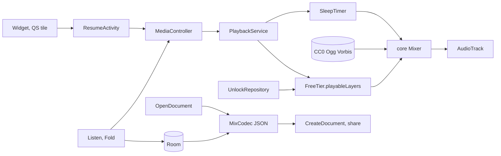

# Rainfold: rain, fan and brown noise that never seams

The apps that own "brown noise" and "rain sounds" on Play are ad businesses with a speaker attached, and their one-star reviews say so: the sound dies after half an hour, an ad with audio fires at 2 a.m., the rain restarts with a click. Rainfold does the core job for nothing, with sound synthesised live so there is no loop to hear and a media service that lasts the night. One optional purchase adds the depth nightly users build with.

## 1. Overview

- **Pitch:** a noise and ambience mixer whose white, pink, brown and green noise, fan and rain are generated in real time, played by a foreground media service that survives idle mode, with a timer that fades out over minutes.
- **Model:** free to download, with one optional one-time unlock (`full_unlock`, purchase option `full-unlock-buy`) at **USD 2.99 / INR 99**. No ads, no subscription, no account, no INTERNET permission.
- **Category:** Health & Fitness (Music & Audio if the Health apps declaration blocks review).
- **Display name** Rainfold; **Play title** Brown Noise: Rain & Fan Sounds; **tagline** Rain, fan and brown noise that never seams.
- **Positioning:** focus and noise-masking sound made live on the phone, all night, with nothing interrupting it.

## 2. Problem and why now

The buyer wants a constant sound over a snoring partner, traffic or an open-plan office, until morning. The free apps fail at exactly that. A live skeptic read the newest one-star reviews (up to 400 per app) on 2026-10-02:

- **Sleep Sounds, Craftsman Spirit** (5M+, 4.82 from 213,540): 116 of 400 mention ads, 85 overnight stops, 58 loop seams ("loops every ten seconds") (https://play.google.com/store/apps/details?id=relax.sleep.relaxation.sleepingsounds).
- **Relax Rain, mikdroid** (5M+, 4.67 from 171,493): 110 ads, including "ads started to have sounds" at night; 62 stops (https://play.google.com/store/apps/details?id=it.mm.android.relaxrain).
- **White Noise Lite, TMSOFT** (5M+): 126 of 400 say it stops after 20 to 30 minutes. **Sleep Aid Fan** (1M+): 75 shut-offs. **Slumber Studios** charges $2 a week; 100 of 293 one-stars are the paywall (https://play.google.com/store/search?q=brown%20noise&c=apps).

Hipxel Noise ranks first for "brown noise" in the US, unchanged since Nov 2024, with a full-screen ad on pause (https://play.google.com/store/apps/details?id=com.hipxel.noise). The ad-free free rivals are narrow or stale: Chroma Doze has noise colours only, no rain, fan or mixing (https://play.google.com/store/apps/details?id=net.pmarks.chromadoze); Noice was last updated Jun 2024 (https://play.google.com/store/apps/details?id=com.github.ashutoshgngwr.noice). 8 of the top 10 for "brown noise" carry ads.

**Findability.** Near-unrated listings reach page one: SmartToolsDev at ranks 3 to 5 for "brown noise" (about 250 installs a month), Veil for "white noise" (about 750). Demand is proven: TMSOFT's paid White Noise holds 100K+ installs and 17,888 ratings (https://www.androidrank.org/application/white_noise/com.tmsoft.whitenoise.full).

**Why 1 to 3 percent buy.** Use is nightly and habitual, which favours paying once; people already pay small one-time sums here (Hipxel ad removal $2.99, Pure Noise $1.49 to $2.99, Lunoire $3.99). This free tier has no ads to remove, so the unlock sells depth alone: expect about 1 percent in the US and 0.5 in India. The nearest benchmark is subscription apps, not single unlocks: RevenueCat's 2026 report puts the Google Play median download-to-paid rate at 0.9 percent and India and Southeast Asia at 0.7 (https://www.revenuecat.com/state-of-subscription-apps).

## 3. Target audience and personas

- **Marisol Ortega, 34, ICU night nurse, Phoenix.** Sleeps from 9 a.m. over a leaf blower. Types **"brown noise"**. **Pays** the week she wants storm as a third layer and "Add layer" says six come with the unlock.
- **Arjun Menon, 27, backend developer, Bengaluru.** Two meetings beside his desk. Types **"brown noise for focus"**. **Pays INR 99** when he saves a fourth mix (work, commute, gym, reading) and wants cafe under brown noise.
- **Siobhan Kelly, 41, teacher, Dublin.** Flat over a bus route. Types **"fan noise for sleeping"**. Lives on the free fan and widget for months; **pays** after an 8-second surf preview in the sound picker.

## 4. Core concept deep-dive

**How it works.** Each layer is a plain Kotlin generator rendered in 1024-frame float blocks at 48 kHz stereo (independent left and right), written to one streaming `AudioTrack` by a render thread in a `mediaPlayback` service. Layers have volume (smoothed, so drags never click), tone (a tilt filter) and, for weather, intensity; a soft limiter guards the master bus.

- **White** xorshift; **pink** Paul Kellet's filtered white; **brown** leaky-integrated white with a DC blocker; **green** white through a broad mid-band band-pass.
- **Fan:** brown and pink under a low-pass, with drifting blade-pass modulation and a faint motor hum.
- **Rain:** a filtered pink bed plus Poisson-scheduled droplets, each a short decaying, slightly rising sine (the bubble-resonance model), random level, pitch and pan; intensity sets the rate.
- **Unlock engines:** storm (heavy rain plus CC0 thunder rolls), wind (gust envelopes), surf (swells on random 8 to 14 second envelopes), stream, fire (crackle bursts on a low bed), air conditioner, train (rumble with paired rail clacks). Textures (crickets, cafe murmur) play from random offsets with long equal-power crossfades.

**The rain gate.** Free rain ships as synthesis only if it passes a blind test: three listeners, ten paired clips against a CC0 recording, synthesis judged "real" or "can't tell" at least half the time. The builder renders the paired 20-second clips in shuffled order with a scoring sheet; the owner runs the listening, and an engine with no recorded pass by the end of week 4 counts as failed. Otherwise free rain becomes the bundled CC0 rain recording with random-offset crossfades, and the listing's "synthesised, not looped" sentence and caption 1 then name only the noise colours and the fan. Each unlock engine faces the same test; a failure leaves v1.0, the product description and the listing (no new recordings are added to fill the gap, so the asset budget holds).

**The one memorable thing: the Fold.** Listen draws the mix as stacked horizontal bands, one per layer, like folded sheets of rain. Each band's top edge is that layer's real spectrum, sampled from its filter response, lows at left: brown slopes down, white is flat, green humps. Height is volume. Drag up or down for volume, sideways to tilt tone. The Fold never moves on its own.

**It refuses** loop files for core sounds, the microphone, sleep tracking, alarms, schedules, downloads, accounts, anything for children and any health claim.

## 5. Complete feature set

### v1.0 Free tier

1. White, pink, brown and green noise, fan and rain, generated live.
2. Mixes of up to 2 layers with volume and tone (rain also intensity).
3. 3 saved mixes: name, reorder, rename, duplicate, delete.
4. Sleep timer, 15 minutes to 10 hours, with a 1 to 30 minute fade, then a clean stop.
5. All-night background playback with lock-screen and notification controls.
6. Audio focus: pauses for calls, ducks under navigation prompts, resumes; pauses when headphones unplug.
7. Home-screen widget (plain RemoteViews) that resumes the last mix in one tap.
8. Export and import of every saved mix as a JSON file.
9. Battery help: OEM restrictions explained, with a button to the system battery optimisation list.

### v1.0 Unlock adds

10. Up to 6 layers. 11. Unlimited named mixes. 12. Storm with thunder, wind, surf, stream, fire, air conditioner, train, crickets and cafe murmur. 13. Evolving night: intensity and tone drift slowly inside a set band. 14. A Quick Settings tile that starts or pauses the last mix.

**Gate points** (`UNKNOWN` counts as locked):
- *Listen, "Add layer" at 2 layers:* the button shows a lock and "Up to 6 layers with the unlock"; tap opens `UnlockRoute("layers")`.
- *Sound picker:* locked sounds sit under "Part of the unlock"; a tap plays an 8-second preview; "Add" opens `UnlockRoute("sounds")`.
- *Save sheet at 3 saved:* "Replace a mix" (free) or "Unlock unlimited mixes" (`UnlockRoute("mixes")`).
- *Timer sheet:* a locked "Evolving night" switch opens `UnlockRoute("evolving")`.
- *Quick Settings tile:* subtitle "Part of the unlock"; tap opens `UnlockRoute("tile")`.
- *Settings:* "Unlock everything" and "Restore purchase".
- *Mixes over the free limits* (imported, or after a refund): kept, renamable, exportable; on play the first two free-eligible layers sound and the rest show muted, "Part of the unlock". Nothing is deleted or hidden.

**Never locked:** any noise colour, fan or rain, the timer, background playback, lock-screen controls, the widget, 3 saved mixes, export and import of every mix, battery help.

**Cut from 1.0, absent from the listing:** per-mix schedules and the wake-up fade-in (a background alarm cannot start a `mediaPlayback` service on Android 12 and later), microphone adaptive masking, the 60-loop asset pack, Oboe, Glance, WorkManager.

**v1.x:** stereo width per layer, a three-mix widget, Hindi and Spanish listings. **v2:** a Wear OS tile.

## 6. Screen-by-screen UX

**Navigation.** Single activity, type-safe Navigation Compose. Bottom bar **Listen, Mixes, Settings**; from 600dp a `NavigationRail` with Listen and Mixes side by side. Sheets: Sound picker, Timer, Save. Routes: `UnlockRoute(reason)`, Licences, Battery help, Privacy.

- **Listen:** the Fold fills the upper two thirds; below, layer rows with volume and tone sliders (the accessible route), "Add layer", a round Play button, the timer chip ("Fades at 06:40"), "Save mix". First launch seeds one brown layer with "Play brown noise".
- **Sound picker:** free sounds, then "Part of the unlock"; tap previews, "Add" adds.
- **Timer sheet:** duration, fade length, "Evolving night", "Start timer".
- **Save sheet:** name, "Save mix"; at the cap, "Replace a mix" or "Unlock unlimited mixes".
- **Mixes:** tap plays, long-press reorders, overflow renames, duplicates, deletes; "Export mixes", "Import mixes".
- **Settings:** theme, default fade, unlock rows, battery help, licences, privacy, opt-in counts, support email (the developer contact address on the Play listing, also used for purchase and refund help).

**The unlock screen.** Title "Unlock everything"; the list of what it adds; "One payment. No subscription."; "Unlock for {formattedPrice}" from Play's `formattedPrice` only; "Not now" exactly as large, never delayed; "Restore purchase"; "The unlock belongs to the Google account that bought it."; the support email. States: **Checking** ("Checking with Google Play"), **Ready**, **Offline** ("Google Play is not reachable. Connect once to buy or restore.", no buy button), **Unavailable** ("Google Play cannot sell the unlock on this phone right now.", no buy button), **Pending** ("Payment pending. Everything opens when Google Play confirms it."), **Owned** ("Everything is unlocked."), **Failed** ("The purchase did not finish. Your mixes are unchanged."). It opens from a gate or Settings, never at launch, on a timer or repeatedly. On its own, once: the first "Saved Desk" confirmation carries "More layers and sounds come with the unlock" and "See what it adds" (flag `unlock_offer_shown`).

**Flow 1, first night.** Marisol taps "Play brown noise" inside a minute, adds Fan, drags it up, sets 4 hours with a 15-minute fade, "Start timer", locks the phone. Idle mode arrives; sound continues; at 1 p.m. it sinks away.

**Flow 2, keeping a mix.** Arjun darkens brown noise, adds Rain, "Save mix", "Desk": "Saved Desk". Next morning the widget resumes Desk. On a new phone: "Export mixes", share, "Import mixes": "Imported 3 mixes."

**Flow 3, the unlock.** Siobhan previews Surf, taps "Add", pays through Google Play, sees "Everything is unlocked.", adds Surf.

## 7. Design system

**Design read:** Reading this as: a night-and-focus sound instrument for adults who want sound to run untouched for hours, with a rain-on-glass and mixing-desk language (stacked sheets of water, a spectrum edge, one cyan light), leaning toward Bricolage Grotesque plus Figtree on a **rain cyan and storm petrol** palette.

**Palette family: rain cyan and storm petrol**, unused elsewhere in the batch; dark mode carries the brand.

**Dials.** Variance 4: one composed screen, calm lists elsewhere. Motion 2: nothing moves unless touched. Density 3: big targets for a hand in the dark.

| Token | Light | Dark | Role |
|---|---|---|---|
| Mist (background) | #E9F1F2 | #0E1E23 | screen and window background |
| Pane (surface) | #F6FAFA | #16292F | sheets, rows, the Fold ground |
| Ink (onSurface, error) | #12262C | #E1EDEE | text, readouts, errors with an icon |
| Drizzle (onSurfaceVariant, outline) | #4A6066 | #93ABB0 | secondary text, tracks, outlines |
| Rain Cyan (primary) | #1A7486 | #6FC2D3 | the one accent: Play, Fold bands, selection |
| Rule (outlineVariant) | #C6D5D8 | #27393F | dividers only |

On-primary is Pane (light), Mist (dark). Rain Cyan, hue 190 at 68 percent saturation light and 53 dark, is identical everywhere. No red: errors are Ink plus an icon. Fold band fills are Rain Cyan at falling opacity, top band strongest; every band's spectrum edge is a 2dp full-opacity Rain Cyan stroke, so each draggable band keeps 4.7:1 or better against Pane in both modes. Contrast, light then dark: Ink on Mist 13.7 and 14.3; Drizzle on Mist 5.8 and 7.1; Rain Cyan on Mist 4.7 and 8.4; on-primary on Rain Cyan 5.1 and 8.4.

**Type.** Google Fonts, SIL OFL 1.1. **Bricolage Grotesque** (soft ink traps, like drops on glass): SemiBold 600 titles 24sp and timer readout 40sp, Medium 500 mix names 18sp. **Figtree:** Regular 400 body 16sp, Medium 500 labels 14sp, SemiBold 600 buttons 15sp. Countdown digits sit in fixed-width slots. No serif. Files `bricolagegrotesque_medium.ttf`, `bricolagegrotesque_semibold.ttf`, `figtree_regular.ttf`, `figtree_medium.ttf`, `figtree_semibold.ttf`; licences `docs/OFL-BricolageGrotesque.txt`, `docs/OFL-Figtree.txt`.

**Radius scale.** RadiusSm 6dp (chips, fields), RadiusMd 14dp (buttons, rows), RadiusLg 28dp (sheet tops, the Fold). The Play button is a full circle, the one rule-based exception.

**Icons.** Material Symbols Rounded via `material-icons-extended`.

**Motion.** No first-run moment. A drag redraws the Fold in-frame; the Play glyph crossfades in 150 ms; sheets use the platform slide. Everything reads `LocalReducedMotion` and snaps.

**States.**
- *Listen:* never empty (seeded); Fold-shaped skeleton while the service connects; "The phone stopped playback. See battery help."; "Playing".
- *Sound picker:* bundled, no loading; during a call "Previews play when the call ends."; "Added Fan".
- *Sheets:* "Give the mix a name, like Desk."; "Fades at 06:40", "Saved Desk".
- *Mixes:* empty "Save a mix from Listen to keep it here." with "Open Listen"; row skeletons past 300 ms; "That file is not a Rainfold mix file."; "Exported 3 mixes", "Imported 3 mixes".
- *Unlock and Settings:* the seven states above; "Purchase restored".
- *Battery help, Licences, Privacy:* static bundled text, so no empty or loading state; the battery button falls back to the app's system settings page when the optimisation list cannot open, with "Open App info and set Battery to Unrestricted."; success is returning to the screen.

**Access.** WCAG AA as measured; 48dp targets; each Fold band has a TalkBack label ("Brown noise, volume 60 percent, darker tone"); text to 200 percent.

**Tablet and foldable.** `--orient unspecified`; state survives rotation; two panes at 600dp; checked at 841x701 and 1280x800 dp.

**Icon brief.** Rain cyan ground #159EBC to #0E809E (hue 191 and 192, saturation 80 and 84, lightness 41 and 34, deep enough that the near-white faces pass 3:1 at the tip), the registry's rainfold row. Mark: one fat raindrop sliced into three stacked slabs, the Fold of sound layers, the top and middle slabs nudged 2 units apart so the stack reads as folded sheets; slab faces near-white #FFFFFF to #E6F7FA, each slab's lower edge storm petrol #12323A, one soft petrol-tinted shadow, the ground showing through the cuts. No wave line, rings or letters. (The earlier Z-ribbon draft read as a letter Z and was replaced.)

**Screenshots (9:16).** Dark 1 to 4, light 5 and 6, mixes "Desk", "Night shift", "Bus route": the Fold playing; a band mid-drag; the timer sheet; lock screen and widget; the picker with surf and storm (unlock); Mixes with "Export mixes".

## 8. Native architecture

**Generator flags line:**
`new-native-app.sh --name "Rainfold" --pkg com.mohdshayan.rainfold --perms "FOREGROUND_SERVICE,FOREGROUND_SERVICE_MEDIA_PLAYBACK,WAKE_LOCK" --unlock full_unlock --room --media3 --orient unspecified --bg "#E9F1F2" --bg-dark "#0E1E23" --dir DEVPROJECTS/rainfold`

No `--glance`, `--work` or `--camerax`. Then delete `implementation(libs.androidx.media3.exoplayer)`: nothing plays a file through ExoPlayer.

**Modules.** `:app` and `:core` (pure Kotlin JVM). Add `kotlin-jvm = { id = "org.jetbrains.kotlin.jvm", version.ref = "kotlin" }`; `:core` applies `kotlin-jvm` and `kotlin-serialization`.

**Package map.** `:core`: `dsp/` (Rng, White, Pink, Brown, Green, Biquad, Tilt, Limiter, Smoother), `engines/` (Fan, Rain, DropletScheduler, the seven unlock engines, TextureVoice), `mix/` (Mixer, FadeCurve, EvolvingDrift, FreeTier, MixCodec), `spectrum/FoldCurve`. `:app`: `audio/` (RenderThread, AudioOut, TextureLoader decoding bundled Ogg Vorbis once with `MediaExtractor` and `MediaCodec`), `playback/` (PlaybackService extends `MediaSessionService`, NoisePlayer extends `SimpleBasePlayer`, FocusController, NoisyReceiver, SleepTimer, Heartbeat), `widget/`, `tile/`, `ui/resume/ResumeActivity` (translucent trampoline that sends play to a `MediaController`), `data/db`, `data/prefs`, `data/export`, `ui/listen`, `ui/mixes`, `ui/settings`, `ui/unlock`, `billing/`. ViewModels Listen, Mixes, Settings, Unlock, each `stateIn(WhileSubscribed(5_000))`. Repositories, all reached through `ServiceLocator`: `MixRepository` (Room DAOs plus `MixCodec` for export and import), `SessionRepository` (the `current_mix_json` and timer keys the service, widget and tile share) and the template's `UnlockRepository`.

**Playback.** Media3 posts the notification and moves the service in and out of the foreground (`foregroundServiceType="mediaPlayback"`). While playing, a `PARTIAL_WAKE_LOCK` is held and the render thread writes `ENCODING_PCM_FLOAT`, `USAGE_MEDIA`, `PERFORMANCE_MODE_POWER_SAVING`; pause releases both. Widget and tile open ResumeActivity (the tile via `startActivityAndCollapse` with a `PendingIntent` on API 34 and up), so playback starts from the foreground. Heartbeat logs frames and `AudioTrack.getUnderrunCount()` under `RainfoldHeartbeat`. If Media3's session misbehaves without network permissions, fall back to platform `MediaSession` with a `MediaStyle` notification.

**Gate code.** `AppNav` provides `LocalUnlock` and owns `UnlockRoute`. `lockedAction("evolving")` wraps the Evolving night switch; `UnlockGate("sounds")` wraps the picker's locked section; count limits call `FreeTier.canAddLayer(entitled, count)` and `canSaveMix(entitled, saved)`, then `open(reason)`. Service, tile and widget read `ServiceLocator.unlock.state.value.unlocked` into `FreeTier.playableLayers(entitled, layers)`. "Add layer" carries an `unlock_` string for `smoke.sh`.

**Catalog aliases.** `androidx-core-ktx`, `androidx-core-splashscreen`, `androidx-lifecycle-runtime-ktx`, `androidx-lifecycle-runtime-compose`, `androidx-lifecycle-viewmodel-compose`, `androidx-activity-compose`, `androidx-compose-bom`, `androidx-ui`, `androidx-ui-graphics`, `androidx-ui-tooling`, `androidx-ui-tooling-preview`, `androidx-material3`, `androidx-material-icons-extended`, `androidx-navigation-compose`, `androidx-room-runtime`, `androidx-room-ktx`, `androidx-room-compiler`, `androidx-datastore-preferences`, `androidx-media3-session`, `android-billingclient`, `androidx-fragment` (constraint), `kotlinx-coroutines-android`, `kotlinx-coroutines-test`, `kotlinx-serialization-json`, `junit`; plugins `android-application`, `kotlin-android`, `kotlin-compose`, `kotlin-serialization`, `ksp`, `kotlin-jvm`. Added `play-review-ktx` (`com.google.android.play:review-ktx:2.0.2`), dropped with its prompt if it merges a permission.

**Sensors** none. **Bundled assets.** `res/raw/` mono Ogg Vorbis at 32 kHz: three thunder rolls, crickets, cafe murmur, a reserve rain recording; under 3 MB. Every clip is CC0 (Freesound filtered to Creative Commons 0), with source URL, author and licence in `README.md` and the Licences screen. Fonts under 1 MB, OFL. The clips are Ogg Vorbis, not Opus: `MediaExtractor` reads Opus in an Ogg container only from Android 10, and minSdk is 26.

**Manifest permissions.**
- `FOREGROUND_SERVICE`: keeps playback running with the screen off.
- `FOREGROUND_SERVICE_MEDIA_PLAYBACK`: the type Android 14 requires for user-started audio.
- `WAKE_LOCK`: holds the CPU only while sound plays.
- `com.android.vending.BILLING`: merged by the billing library; asks the Play Store app to sell and confirm the unlock.
- `com.mohdshayan.rainfold.DYNAMIC_RECEIVER_NOT_EXPORTED_PERMISSION`: merged by androidx.core for the headphone receiver.

`INTERNET` and `ACCESS_NETWORK_STATE` are removed with `tools:node="remove"` (billing and Media3 merge them; no WorkManager). No `POST_NOTIFICATIONS`: media session notifications are exempt. The release APK lists exactly these five.

**Background work, widgets, tiles.** One foreground service, only while playing. No WorkManager, AlarmManager or boot receiver. One RemoteViews widget, one `TileService`.



## 9. Data model

**Room, version 1.**
- `Mix`: `id: Long` PK autogenerate, `name: String`, `sortOrder: Int`, `evolving: Boolean`, `driftRange: Float`, `createdAt: Long`, `updatedAt: Long`, `lastPlayedAt: Long?`.
- `MixLayer`: `id: Long` PK, `mixId: Long` FK cascade, indexed, `position: Int`, `engine: String` (WHITE, PINK, BROWN, GREEN, FAN, RAIN, STORM, WIND, SURF, STREAM, FIRE, AIR_CON, TRAIN, CRICKETS, CAFE), `volume: Float`, `tone: Float` (-1 to 1), `intensity: Float`.

**DataStore keys.** `current_mix_json` (the unsaved Listen mix the widget resumes), `last_mix_id`, `timer_minutes` (240), `fade_minutes` (10), `theme_mode`, `unlock_offer_shown`, `qualifying_days`, `last_qualifying_day`, `review_prompted`, `usage_counts_opt_in` (false), `count_nights`, `count_mixes_saved`. The entitlement lives only in the template's `entitlement` DataStore file, excluded from backup and transfer, never in Room or an export.

**Export and import.** `rainfold-mixes-YYYY-MM-DD.json` via `CreateDocument` or share: `{"format":"rainfold-mixes","schema":1,"mixes":[{"name":"Desk","evolving":false,"driftRange":0.3,"layers":[{"engine":"BROWN","volume":0.62,"tone":-0.35,"intensity":0.5}]}]}`. Import via `OpenDocument` checks `format` and `schema`, merges in one transaction, renames clashes "Desk (2)" and skips unknown engines. The codec writes nothing else and ignores unknown keys, so no entitlement travels. The free cap limits saving, never import.

## 10. Pricing and countries

**USD 2.99, INR 99**, hand-set and tax-inclusive: tier A of the unlock ladder, as `wave4_decision` fixes. Bulk-set USD, hand-set India, read saved prices back. All countries.

- Product id `full_unlock`, purchase option `full-unlock-buy`, Buy, no offers.
- **Product name:** Rainfold full unlock (20 characters).
- **Product description:** Up to 6 layers, unlimited mixes, storm, wind, surf, stream, fire, air conditioner, train, crickets and cafe sounds, evolving night mode and a Quick Settings tile. (162 characters)

**Why this rung.** One-time prices here cluster at $0.99 to $3.99 (Hipxel ad removal $2.99, Pure Noise up to $2.99, TMSOFT $0.99, Lunoire $3.99); $2.99 matches the ad-removal price buyers know while selling more than silence. INR 99 is about a third of Play's conversion (about INR 340). No launch sale, no countdown. **Refunds:** Play's 48-hour window, then on request through the support email for 14 days; a refund relocks gracefully and keeps every mix.

## 11. Play Store listing

**Title (30):** Brown Noise: Rain & Fan Sounds

**Short description (79):** Brown, white and green noise, fan and rain made live for focus and sleep sounds

**Full description (1,837):**

```
Brown noise, white noise, rain sounds and fan noise for focus or for sleeping, made live on your phone so there is no loop seam, and it keeps playing through the night.

What is free:
- White, pink, brown and green noise, a fan and rain, generated as they play
- Mixes of two layers, each with its own volume and tone
- Three saved mixes
- A sleep timer with a long, slow fade
- Background playback with lock-screen controls
- A widget that resumes your last mix with one tap
- Export and import of your mixes as a file

What the one purchase adds:
- Up to six layers in a mix
- Unlimited named mixes
- Storm with thunder, wind, surf, stream, fire, air conditioner and train
- Crickets and cafe murmur, synthesised like every other sound
- Evolving night: intensity drifts slowly, so no two hours sound alike
- A Quick Settings tile

Free to use. One optional purchase unlocks everything, once, for good. No ads, no subscription, no account. Works fully offline.

It keeps going. Rainfold plays through a media service built for long playback and holds steady while the phone sits idle. It pauses for calls, then picks up again, and pauses when headphones are unplugged.

There is no seam. The noise colours, the fan and the rain are synthesised as they play, not looped from a short file, so nothing clicks or restarts.

For focus and noise masking: cover office chatter, traffic or a humming fridge while you read, study or rest.

Screenshots marked as part of the unlock show features the purchase adds.

Buying or restoring the unlock goes through Google Play and needs a connection once. After that everything works offline.
The unlock belongs to the Google account that bought it and comes back on a reinstall or a new phone.

The app has no internet permission and collects nothing. Rainfold is a sound app, not a medical device, and makes no health claims.
```

**Keywords:** brown, white, pink and green noise, rain sounds, fan noise for sleeping, sleep sounds, noise masking.

**Screenshot captions:** 1 "Brown noise, fan and rain, made live". 2 "Drag a layer for volume and tone". 3 "A sleep timer that fades out slowly". 4 "Lock-screen controls and a one-tap widget". 5 "Storm, surf and fire, part of the unlock". 6 "Your mixes, saved and exported as a file".

**Feature graphic.** The cyan gradient, the sliced-drop mark at left, "Rainfold" in Bricolage Grotesque in white, "Noise, fan and rain made live, all night", the light Listen screenshot with brown noise in the Fold framed at right (store/feature-shot.png, a copy of the emulator smoke capture). No price or badge.

**Category** Health & Fitness. **Content rating** IARC, expected Everyone, with "In-App Purchases". **Target age** 18 and over.

## 12. Policy and data safety

- **Data safety:** "No data collected, no data shared", true only while `INTERNET` is absent from every APK on closed, open and production tracks (gate 10b, and `aapt2 dump permissions` on the Play-generated APK), no obfuscated account id is set, and no analytics or crash SDK exists.
- **Ads:** No. **Content rating:** Yes to digital purchases, No to random items.
- **Health apps declaration:** a general sound app for focus and relaxation, not a medical device. No claim about sleep quality, insomnia, tinnitus or babies.
- **Foreground service declaration:** `mediaPlayback`, with a video of a user starting sound and locking the phone.
- **App access:** no login, no reviewer code. **Advertising ID, financial, government:** No.
- **Privacy policy**, hosted and in the app: no data collected; the section 8 permission lines, including "com.android.vending.BILLING: lets the app ask the Google Play Store app to sell and confirm the one-time unlock"; a Purchases paragraph (the purchase happens in the Google Play Store app under Google's terms; the app only reads whether this Google account owns the unlock, keeps that on the phone and sends nothing). Pass BILLING to `make-privacy-policy.py` and add the paragraph by hand.
- **Must not claim:** any paid-only phrase from recipe 11b, any price, offline buying, any health benefit.

## 13. Organic growth

The title carries "brown noise", the winnable head term, plus "rain" and "fan sounds"; the short description adds "white", "green noise", "focus" and "sleep sounds"; the description's first line carries rain sounds and fan noise for sleeping. Screenshot 1 shows the Fold playing brown noise.

**Review prompt:** `review-ktx`, once, after the third qualifying day (a 30-minute session or a completed fade), when the user next stops playback by hand on Listen. Never in the first session, while sound plays, from a button, or near the unlock screen. No reward for a rating.

**Launch:** a 30-second recording of storm coming in under brown noise, posted within one focus subreddit's rules. **Not done:** paid UA, incentivised reviews, competitor names, a twin listing.

## 14. KPIs

From Play Console, weekly: **installs**; **buyers per install by country** from Order management and Statistics; **refunds**; and **the rating trend**, reading every one-star that mentions stopping or "not free". In the app, local-only and opt-in from Settings (off by default, never sent): nights played and mixes saved, shown only to the user. Working means: a rating at or above 4.5 after the first 50 ratings, about 1 percent buyers per install in the US and 0.5 percent in India, and refunds under 10 percent of orders.

## 15. Risks and mitigations

1. **Synthesis that sounds like hiss.** Every engine passes the blind test before the listing is written; free rain falls back to the bundled CC0 recording, and a failed unlock engine is cut from v1.0.
2. **Overnight stops, the hardest subsystem.** Gate: an 8-hour emulator run under `dumpsys deviceidle force-idle` with the heartbeat showing no gap and no new underruns, then a night on the S22+ under the shared phone lock.
3. **Biggest free incumbents** (Craftsman, Relax Rain, TMSOFT Lite) own the head terms; Rainfold fights on "brown noise" and its long tail.
4. **Ad-free rivals** (Chroma Doze, Noice) mean the unlock sells depth only; the preview is the persuader.
5. **Refund window.** Previews before purchase prevent most 48-hour refunds; a refund keeps every mix.
6. **Billing without INTERNET is unproven at runtime.** The owner's device test (UNLOCK-RESEARCH.md 6.4) gates production.
7. **Health declaration friction:** move to Music & Audio with the same copy.

## 16. Competitive landscape

| App | Price | Installs | Rating | Updated | Why pick Rainfold |
|---|---|---|---|---|---|
| Sleep Sounds (Craftsman Spirit) | Free, ads, IAP | 5M+ | 4.82 | Feb 2026 | No ads at night, no seam. |
| Relax Rain (mikdroid) | Free, ads, IAP | 5M+ | 4.67 | Sep 2026 | No audio ads; rain not looped. |
| White Noise Lite (TMSOFT) | Free, ads | 5M+ | 4.55 | Sep 2026 | Plays past half an hour. |
| Sleep Sounds (Leap Fitness) | Free, ads, IAP | 5M+ | 4.75 | Nov 2025 | No unskippable ads. |
| Noise (Hipxel) | Free, ads, $2.99 removal | 100K+ | 4.74 | Nov 2024 | Same live noise with no ads; maintained, adds fan, rain, mixing. |
| Brown Noise and Pink Noise (Vazquez) | Free, ads, $4.59 | 100K+ | 4.10 | Sep 2026 | No silence gaps. |
| Chroma Doze | Free | 100K+ | 4.73 | Jul 2025 | Rain, fan and mixing. |
| Noice | Free, premium tier | 100K+ | 4.71 | Jun 2024 | Maintained, synthesised. |
| White Noise (TMSOFT) | $0.99 plus IAP | 100K+ | 4.52 | Sep 2026 | Core costs nothing. |

## 17. Development plan

- **Week 1, sound and service:** generate; `:core` noise colours, Fan, filters, Limiter, FadeCurve with tests; RenderThread; PlaybackService, focus, noisy receiver, wake lock. Brown noise plays with the screen off.
- **Week 2, rain and Listen:** Rain and its blind-test clips; the Fold and Listen; the mixer with smoothing and the limiter; SleepTimer and FadeCurve in the service.
- **Week 3, data and the unlock:** Room, Mixes, Save sheet, export and import; widget, ResumeActivity; `FreeTier`, every gate, the unlock screen and its seven states; the 16 `EntitlementTest` cases unchanged.
- **Week 4, unlock engines:** the seven engines and two textures, with their blind-test clips; EvolvingDrift; the tile. Blind-test results recorded by the end of the week.
- **Week 5, finish:** fonts, tokens, states, tablet panes, licences, battery help, review prompt, icon, screenshots, listing; `build.sh`, `verify.sh`, `smoke.sh`; the 8-hour Doze run.
- **Week 6, proof:** the S22+ night, the owner's billing test, fixes. **Total: 6 weeks.**

**Cut if behind:** Stream and Fire move to 1.1 and leave the product description and listing; then Train and Air conditioner do the same. The free tier never shrinks.

**JVM tests (`:core`):** pink falls about 3 dB and brown about 6 dB per octave (FFT, within 1.5 dB); six full layers never pass the limiter ceiling; a seed reproduces its block; crossfades hold constant power; FadeCurve is monotonic and ends at zero; droplet rate scales with intensity; EvolvingDrift stays in range over 8 simulated hours; `FreeTier` rules entitled and not, including a 6-layer mix after a relock; MixCodec round-trips, rejects a wrong `format` and never writes an unlock key; release has no debug unlock.

**Emulator smoke:** sound inside a minute; 10 minutes screen-locked; `adb emu gsm call` pauses and resumes; a 1-minute fade stops cleanly; the fourth save offers both options; export, clear data, import; every gate opens the unlock screen; rotation, dark and light; widget and tile resume; kill and relaunch keeps mixes.

**android-ship preflight:** the five permissions exactly, billing version meta-data present, foreground service type declared, privacy policy hosted before Data safety, CC0 and OFL licences in README and app, zero em or en dashes.
